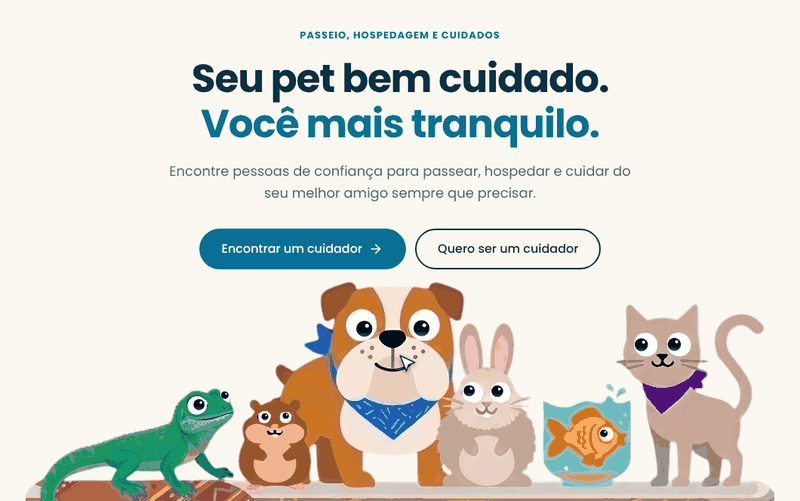
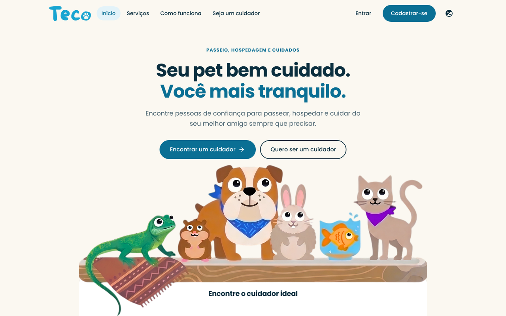
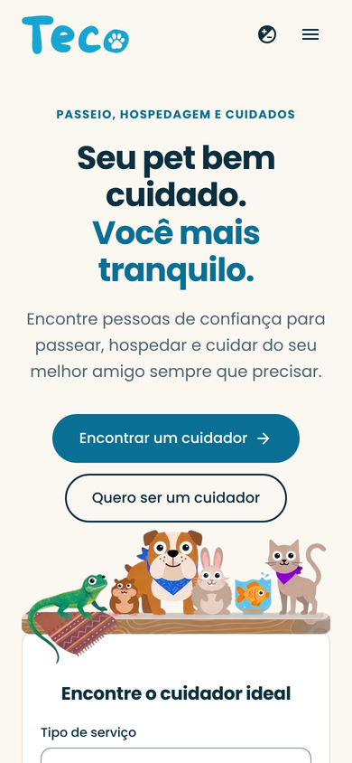
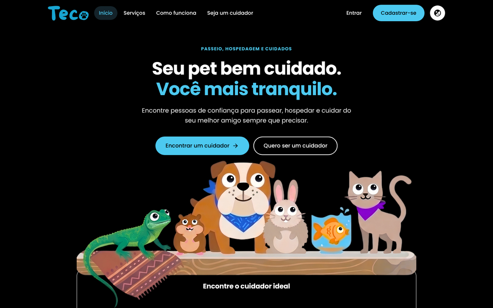

<div align="center">


**Seu pet bem cuidado. Você mais tranquilo.**

🔗 **[Ver o site no ar](https://ianisaque.github.io/teco/)**

O Teco conecta tutores de pets a pessoas que oferecem passeio, hospedagem e cuidados por algumas horas.



</div>

> **Projeto de demonstração.** A interface funciona, com uma API local opcional, mas os cuidadores, as avaliações, os preços e os depoimentos são **exemplos**. Ainda não existem banco de dados, autenticação nem agendamento.

## Sobre o projeto

Quem tem um pet nem sempre consegue estar presente: uma viagem, um dia corrido, um passeio que não dá para fazer. O Teco é a ideia de uma plataforma que aproxima esse tutor de alguém de confiança, seja para passear, hospedar ou cuidar do bichinho por algumas horas.

Este repositório é o front-end da plataforma, com uma pequena API em Python que serve dados de demonstração. O foco foi construir uma experiência de uso completa e bem cuidada, sem frameworks, com HTML, CSS e JavaScript puros.

## Funcionalidades

- **Hero interativo:** seis bichos em pé sobre o card de busca, com os olhos acompanhando o cursor. No celular, que não tem cursor, eles olham em volta sozinhos. Quem desativa animações no sistema vê os bichos parados.
- **Busca por serviço, região e data**, com validação e mensagens de erro. Os filtros de serviço e região são aplicados pela API local ou, no GitHub Pages, no próprio navegador.
- **Cuidadores em destaque:** cards com foto, região, serviços, avaliação e preço, com estados de carregamento, lista vazia e erro. O perfil abre em uma janela.
- **"Saber mais" de cada serviço:** janela com a explicação do serviço, os cuidadores de demonstração que o oferecem e um botão que aplica o filtro na lista.
- **Entrar e cadastrar-se**, com validação dos campos (nada é enviado nem salvo).
- **Alto contraste**, com a preferência lembrada entre visitas.
- **Responsivo** para computador, tablet e celular.

<table>
  <tr>
    <td align="center"></td>
    <td align="center"></td>
  </tr>
  <tr>
    <td align="center">Computador</td>
    <td align="center">Celular</td>
  </tr>
</table>

<p align="center">
  <br>
  Modo de alto contraste
</p>

## Tecnologias

- **HTML5, CSS3 e JavaScript** (módulos ES), sem bibliotecas nem frameworks.
- **Python 3**, só com a biblioteca padrão (`http.server`), para servir o site e a API ao rodar localmente.
- Ícones do [Material Design Icons](https://pictogrammers.com/library/mdi/) e fonte [Poppins](https://fonts.google.com/specimen/Poppins), ambos guardados no próprio projeto.

## Como executar

Requer Python 3.8 ou superior. Não há dependências para instalar.

```bash
git clone https://github.com/Ianisaque/teco.git
cd teco
python app.py
```

Depois abra http://localhost:8000. Para usar outra porta, defina a variável de ambiente `PORT`.

## Estrutura

```
app.py                    servidor e API (biblioteca padrão do Python)
docs/                     imagens usadas neste README
public/                   tudo que o navegador acessa
  index.html
  data/cuidadores.json    dados de demonstração
  css/                    styles.css e servicos.css
  js/
    main.js               ponto de entrada
    components/           nav, busca, cuidadores, olhos dos pets, serviços, formulários...
    services/api.js       acesso aos dados (API ou arquivo JSON), ponto único para integrações futuras
    lib/                  utilitários e tipos de serviço
  img/                    logo, avatares, ilustração dos pets, ícones
  fonts/                  Poppins
```

Só a pasta `public/` fica acessível pelo navegador (e é ela que vai para o GitHub Pages). O `app.py` não é servido.

## Publicar no GitHub Pages

O site funciona sem servidor: no GitHub Pages não existe a API do `app.py`, então o navegador lê `public/data/cuidadores.json` e aplica os mesmos filtros em JavaScript (`public/js/services/api.js`). A publicação é automática, pelo workflow `.github/workflows/pages.yml`.

1. No repositório, abra **Settings > Pages**.
2. Em **Build and deployment > Source**, escolha **GitHub Actions**.
3. Faça um push na branch `main` (ou rode o workflow em **Actions > Publicar no GitHub Pages > Run workflow**).
4. Quando terminar, o site fica em https://ianisaque.github.io/teco/.

## API local

Disponível só ao rodar `python app.py`.


| Rota | Descrição |
| --- | --- |
| `GET /api/cuidadores` | Lista cuidadores. Aceita `?servico=passeio\|hospedagem\|cuidados` e `?bairro=Botafogo`. |
| `GET /api/bairros` | Regiões atendidas pelos cuidadores cadastrados. |

## Como os olhos funcionam

O `index.html` tem um SVG sobre a imagem dos pets, com uma pupila para cada olho. Cada olho guarda no HTML o centro e o raio da parte branca (atributos `data-*`, em coordenadas da imagem). O `public/js/components/pet-eyes.js` calcula a direção do cursor e move cada pupila sem deixá-la sair do olho. A imagem (`public/img/pets.webp`) não tem pupilas, elas são sempre desenhadas pelo SVG. Para trocar a imagem, é preciso refazer essas medidas.

## Acessibilidade

- Link para pular direto ao conteúdo e foco visível em todos os controles.
- Campos com rótulo e mensagens de erro ligadas a eles.
- Janelas modais com o elemento `<dialog>`, que fecham com `Esc`.
- Respeito à preferência do sistema por menos movimento (`prefers-reduced-motion`).
- Modo de alto contraste.

## Próximos passos

- Banco de dados no lugar de `public/data/cuidadores.json` (função `carregar_cuidadores` em `app.py`).
- Autenticação: rotas de login e cadastro, ligadas a `public/js/components/auth-forms.js`.
- Agendamento por data, para que o campo de data da busca passe a filtrar a disponibilidade.

## Créditos

- Ícones: [Material Design Icons](https://pictogrammers.com/library/mdi/) (Apache License 2.0).
- Fonte: [Poppins](https://fonts.google.com/specimen/Poppins) (SIL Open Font License).
- Logo e identidade visual: arquivos do projeto original.
- Avatares dos cuidadores: ilustrações originais geradas em SVG para este projeto. Todos os perfis são fictícios.
- Ilustração dos pets e ícones dos serviços: fornecidos pelo autor do projeto.
